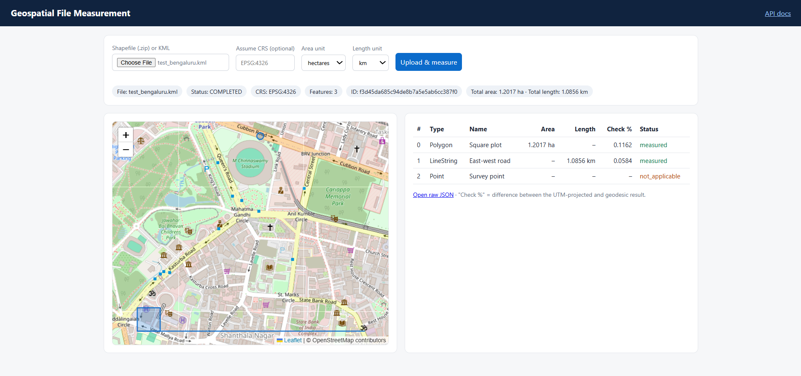
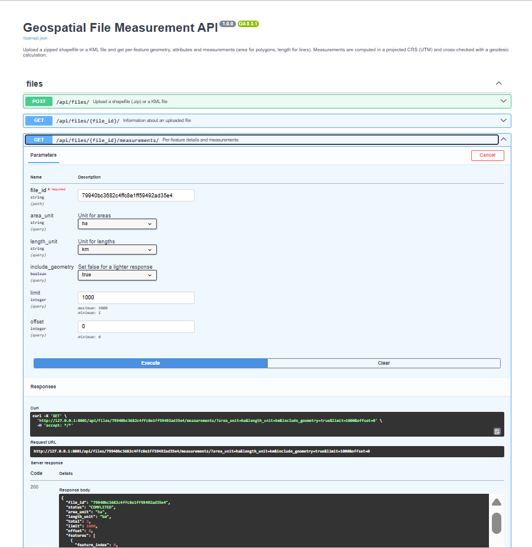
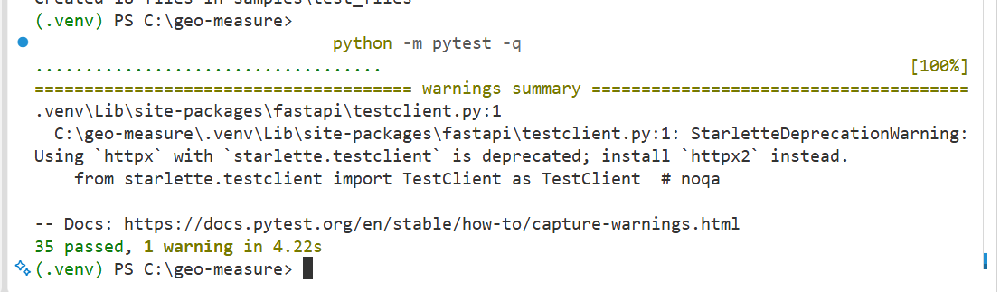

# Geospatial File Measurement API


A FastAPI backend that accepts a **zipped shapefile** or a **KML** file, extracts every feature
(ID, geometry type, geometry, CRS, attributes) and returns real-world **measurements**:
area for polygons, length for lines. Measurements are computed in a projected CRS (never in
latitude/longitude degrees) and **cross-checked with an independent geodesic calculation**.

A small web UI (upload, results table, map, unit switcher) is included at `/`.



## Highlights

- **Three endpoints** as specified: upload, file info, per-feature measurements
- **Correct measurement:** each feature is measured in its own UTM zone, then verified on the WGS 84 ellipsoid; the difference is reported (`discrepancy_pct`)
- **Robust input handling:** zip-slip protection, size and file-count limits, KML validation, missing-CRS handling (`assume_crs`), one bad feature never fails the whole file
- **Geometry health:** invalid polygons are repaired and flagged with a warning; unsupported types are reported, not crashed on
- **Units:** m² / km² / hectares / acres / ft² and m / km / ft / miles
- **Consistent errors** with machine-readable codes, pagination, and a file summary
- **35 automated tests** plus a generator for deliberately broken and tricky sample files

## Contents
[Setup](#setup) · [Web UI](#web-ui) · [API](#api) · [How measurement works](#how-measurement-works) · [Architecture](#architecture) ·
[Design decisions](#design-decisions) · [Limitations](#limitations) · [Testing](#testing) · [Learning](#learning) ·
[Future scope](#future-scope) · [Development notes](#development-notes)

---

## Setup

Requires **Python 3.11+**. No system GDAL install is needed; the geospatial libraries ship as wheels.

```bash
git clone https://github.com/Afrin26S/geospatial-file-measurement-api.git
cd geospatial-file-measurement-api

python -m venv .venv
source .venv/bin/activate          # Windows: .venv\Scripts\activate
pip install -r requirements.txt

uvicorn app.main:app --reload      # add --port 8001 if port 8000 is blocked
```

| What | Where |
|---|---|
| Web UI | http://127.0.0.1:8000/ |
| Interactive API docs (Swagger) | http://127.0.0.1:8000/docs |
| Health check | http://127.0.0.1:8000/health |

A sample file is included: `samples/test_bengaluru.kml` (a polygon, a line and a point), and
`samples/shp_utm.zip` (a shapefile in a projected CRS, EPSG:32643).

**Configuration** (optional environment variables)

| Variable | Default | Meaning |
|---|---|---|
| `DATABASE_URL` | `sqlite:///./geo_measure.db` | Any SQLAlchemy URL (e.g. PostgreSQL) |
| `UPLOAD_DIR` | `uploads` | Where uploaded files are stored |

Tables are created automatically on startup.

---

## Web UI

Open `/`, choose a `.zip` (shapefile) or `.kml`, pick units and click **Upload & measure**.
The page shows the file summary, a table of every feature (area, length, check %, status), and a
map. Click a row to zoom to the shape; click a shape to highlight its row. Changing units
re-fetches the results without re-uploading.

The map preview draws files in EPSG:4326 (all KML files). For a shapefile in another CRS the table
is still correct and the page says why the map is not shown.

---

## API



### `POST /api/files/` — upload and process

Multipart form with one field, `file`: a `.zip` containing a shapefile, or a `.kml`.
Optional query parameter `assume_crs` (e.g. `EPSG:4326`) for a shapefile that has no `.prj`.

```bash
curl -X POST "http://127.0.0.1:8000/api/files/" -F "file=@samples/test_bengaluru.kml"
```

`201 Created`:

```json
{
  "id": "e23e8a9573864e27b12e3cf25352abea",
  "filename": "test_bengaluru.kml",
  "feature_count": 3,
  "crs": "EPSG:4326",
  "status": "COMPLETED",
  "kind": "kml",
  "crs_assumed": false,
  "created_at": "2026-10-09T09:15:28.592891",
  "summary": {
    "features_by_type": { "Polygon": 1, "LineString": 1, "Point": 1 },
    "features_by_status": { "measured": 2, "not_applicable": 1 },
    "total_area_sq_m": 12016.9781,
    "total_length_m": 1085.6045
  },
  "error": null
}
```

### `GET /api/files/{id}/` — file information

Same body as above. For a file that could not be processed, `status` is `FAILED` and `error`
holds the `code` and `message`.

### `GET /api/files/{id}/measurements/` — per-feature results

| Query parameter | Default | Description |
|---|---|---|
| `area_unit` | `sq_m` | `sq_m`, `sq_km`, `ha`, `acre`, `sq_ft` |
| `length_unit` | `m` | `m`, `km`, `ft`, `mi` |
| `include_geometry` | `true` | `false` returns a lighter response |
| `limit` / `offset` | `1000` / `0` | Pagination (`limit` 1–5000); `total` is in the response |

```bash
curl "http://127.0.0.1:8000/api/files/e23e8a9573864e27b12e3cf25352abea/measurements/?area_unit=sq_m&length_unit=m"
```

`200 OK` (first feature shown; attributes shortened for readability):

```json
{
  "file_id": "e23e8a9573864e27b12e3cf25352abea",
  "status": "COMPLETED",
  "area_unit": "sq_m",
  "length_unit": "m",
  "total": 3,
  "limit": 1000,
  "offset": 0,
  "features": [
    {
      "feature_index": 0,
      "geometry_type": "Polygon",
      "geometry": {
        "type": "Polygon",
        "coordinates": [[[77.5946, 12.9716, 0], [77.5956, 12.9716, 0],
                         [77.5956, 12.9726, 0], [77.5946, 12.9726, 0],
                         [77.5946, 12.9716, 0]]]
      },
      "crs": "EPSG:4326",
      "properties": { "Name": "Square plot" },
      "measurement": {
        "status": "measured",
        "area": 12016.978112,
        "length": null,
        "projected_crs": "EPSG:32643",
        "geodesic_area": 12003.034817,
        "geodesic_length": null,
        "discrepancy_pct": 0.1162,
        "warnings": []
      }
    }
  ]
}
```

The `LineString` of the sample has `length` ≈ 1085.604 m (geodesic 1084.971 m); the `Point` has
`status: "not_applicable"` and no measurement.

**Measurement `status` values:** `measured`, `not_applicable` (points), `unsupported`
(e.g. `GeometryCollection`), `empty` (no geometry), `failed` (an unexpected error on that feature
only; the rest of the file is unaffected).

### Errors

Every error uses one shape:

```json
{ "error": { "code": "bad_zip", "message": "File is not a valid zip archive", "file_id": "…" } }
```

| HTTP | `code` | When |
|---|---|---|
| 413 | `file_too_large`, `zip_too_large`, `zip_too_many_files` | Upload or unzipped size/file-count limit exceeded |
| 415 | `unsupported_type` | Not a `.zip` or `.kml` |
| 422 | `empty_file`, `bad_zip`, `no_shapefile`, `unsafe_zip`, `invalid_kml`, `unreadable`, `no_features`, `mixed_crs` | File cannot be read |
| 422 | `missing_crs`, `bad_assume_crs` | No coordinate system and none supplied, or an invalid one |
| 422 | `validation_error` | Bad request (e.g. unknown unit, missing file) |
| 404 | `not_found` | Unknown file id |
| 409 | `file_not_ready` | Measurements requested for a file that is not `COMPLETED` |
| 500 | `processing_failed` | Unexpected server error (the file is recorded as `FAILED`) |

Files that fail while processing are stored with status `FAILED`, so the cause can be looked up
later with `GET /api/files/{id}/`.

---

## How measurement works

**Why not just use the coordinates?** Latitude/longitude are angles, not distances. One degree of
latitude is about 111 km everywhere, but one degree of longitude shrinks with latitude (about
108 km at Bengaluru, 104 km at Cuttack). A "square" of 0.001° near Bengaluru is about
110 m × 108 m, so area computed on raw coordinates is meaningless.

For every polygon and line, `app/services/measure.py` does the following:

1. Points → `not_applicable`; unsupported types → `unsupported`; empty → `empty`. None of these crash.
2. Altitude (Z) is dropped so both methods measure the same flat footprint.
3. An invalid polygon (e.g. a self-crossing "bow-tie") is repaired with `make_valid` and a
   warning is attached.
4. **Projected method (the reported value):** the UTM zone is chosen from the feature's own
   location, the geometry is transformed to it, and area/length are computed in metres.
5. **Geodesic method (cross-check):** the same geometry is measured directly on the WGS 84
   ellipsoid with `pyproj.Geod`.
6. The difference is reported as `discrepancy_pct`; above 0.5 % a warning is added.

**Expected accuracy.** UTM is very accurate inside its 6°-wide zone, but grid distances are
slightly stretched away from the zone's central meridian. For the sample plot (about 280 km east
of the zone 43 central meridian) the two methods differ by 0.12 %, which matches the theory.
The geodesic value is the reference; the projected value is what the API reports as the main
result.

---

## Architecture

```
app/
  main.py              FastAPI app, error handlers, serves the UI
  api/files.py         The three endpoints (thin: validation, HTTP mapping)
  services/
    reader.py          Safe file reading: zip handling, KML/shapefile loading, attribute cleaning
    measure.py         CRS selection and area/length calculation (no web or DB code)
    processing.py      Orchestrates one upload: read → measure each feature → save
    units.py           Unit conversion factors
  models.py            SQLAlchemy tables: UploadedFile, FeatureRecord
  schemas.py           Pydantic response models
  errors.py            One consistent error format
  static/index.html    Single-page web UI (Leaflet map)
samples/               Example input files
tests/                 pytest suite
make_test_files.py     Generates valid, tricky and deliberately broken test files
.github/workflows/     CI: runs the tests on every push
docs/                  Screenshots used in this README
```

**File-processing flow**

1. `POST /api/files/` checks the extension (415 otherwise) and **streams** the upload to disk
   in chunks, enforcing a size limit. The file is stored under a random id, never under the
   client's filename.
2. A row is created with status `PROCESSING`.
3. `reader.read_geofile` loads the file:
   - **Zip:** only shapefile parts (`.shp .shx .dbf .prj .cpg`) are extracted, paths that try to
     escape the target folder are rejected (zip-slip), and the *actual* bytes written are counted
     against a limit (zip bombs).
   - **KML:** checked to look like KML, then **every** layer (KML folder) is read.
   - A missing CRS is rejected unless `assume_crs` is supplied.
4. `processing.process_file` measures each feature, stores one `FeatureRecord` per feature,
   builds the summary and sets the status to `COMPLETED`. A failure on one feature marks only
   that feature `failed`.
5. `GET` endpoints read the stored results and convert units at response time (values are stored
   in square metres / metres).

---

## Design decisions

| Decision | Chosen | Alternatives considered | Why |
|---|---|---|---|
| Framework | FastAPI | Django + DRF | Typed request/response models and automatic docs with little code; Django's geo stack (GeoDjango) needs a system GDAL install |
| Projected CRS | UTM zone chosen **per feature** | Web Mercator; one CRS per file; equal-area only | Web Mercator distorts area badly; a file can span several zones; UTM is accurate to roughly 0.1 % within a zone |
| Accuracy check | Geodesic result alongside | Trust the projection | Gives users a measured error bound instead of an assumption |
| Processing | Synchronous in the request | Background queue (Celery/RQ) | Upload size is capped, so processing is quick; the `status` field already models an async flow |
| Database | SQLite by default, URL configurable | PostgreSQL/PostGIS | Zero setup for reviewers; no spatial queries are needed, so geometry is stored as GeoJSON text |
| Stored geometry | Original CRS, as GeoJSON | Reproject to WGS 84 | Keeps the file's data intact; `crs` is returned per feature |
| Errors | One JSON shape, machine-readable `code` | Default FastAPI errors | Predictable for clients and the UI |
| Failed uploads | Recorded as `FAILED` | Not stored | The cause stays retrievable |
| Units | Stored in SI, converted on read | Store per unit | One source of truth; no re-processing to change units |
| Security | Random ids, zip-slip check, size caps, KML sniffing | — | Uploads are untrusted input |

---

## Limitations

- **KMZ** is not supported (use `.kml`).
- Several shapefiles in one zip must share the same CRS.
- The map preview draws only files in EPSG:4326; the table is correct for any CRS.
- Geometries larger than a UTM zone, or crossing zone boundaries, lose some accuracy
  (the geodesic cross-check shows by how much).
- No database migrations; changing the schema means recreating the SQLite file.
- Uploaded files are kept on disk and not yet cleaned up.
- No authentication or rate limiting (out of scope for this exercise).

---

## Testing

```bash
python -m pytest -v
```



**Automated (35 tests).** They check real numbers rather than just "it runs": a square built to be
exactly 100 m × 100 m must measure 10 000 m² after a round trip through latitude/longitude;
polygons with holes and multi-part geometries; invalid polygons; unsupported and empty geometry;
zip-slip and corrupt zips; a missing `.prj`; unit conversion; pagination; and every error response.

**Manual test files.** Generate a set of valid, tricky and deliberately broken files:

```bash
python make_test_files.py
```

This creates `samples/test_files/` with a `README.txt` stating what each file should produce:
a corrupt zip, a zip-slip zip, an empty file, a malformed KML, mixed-CRS shapefiles, a KML with a
polygon hole, an invalid bow-tie polygon and a mixed `MultiGeometry`, and a KML with 2 500 features
to exercise pagination. The generated folder is git-ignored.

**Continuous integration.** `.github/workflows/tests.yml` installs the dependencies and runs the
test suite on every push and pull request.

---

## Learning

- **Degrees are not metres.** The main concept I had to learn was coordinate reference systems.
  Latitude and longitude are angles, so one degree of longitude is about 108 km at Bengaluru and
  shrinks further from the equator. Measuring area on raw coordinates gives meaningless numbers,
  so each feature is transformed into its own UTM zone before it is measured.
- **Check a result two ways.** I compared the UTM result with a geodesic calculation on the
  WGS 84 ellipsoid. For my Bengaluru sample they differ by 0.12 %. UTM stretches distances slightly
  away from the zone's central meridian, and the sample is about 280 km from it, so I report this
  gap in every response instead of hiding it.
- **Treat uploads as untrusted.** Zip-slip paths, zip bombs, fake extensions, corrupt files and
  shapefiles without a `.prj` are all realistic inputs. I wrote a generator for broken and tricky
  files (`make_test_files.py`) and ran each one through the API and the web UI. That pushed me to
  design the error responses first.
- **Tests with known answers.** A shape built to be exactly 100 m × 100 m must come back as
  10,000 m² after a round trip through latitude/longitude. That gave me much more confidence than
  a test that only checks the code runs.
- **Verify beyond my own machine.** My first `git add .` staged the whole virtual environment, so
  I learned to read `git status` before every commit. I also checked the project from a fresh
  clone and with CI, since "it works on my laptop" proves little.
- **I was surprised that the map labels appear in different scripts, because OpenStreetMap shows names in each region’s local language.**

## Future scope

- Return geometry in WGS 84 as an option, so the map works for projected shapefiles
- Background processing (queue + worker) with progress reporting for very large files
- Support GeoJSON and KMZ uploads, and a bounding box in the summary
- PostgreSQL/PostGIS, database migrations (Alembic), and cleanup of stored uploads
- Equal-area projection or geodesic-only mode for very large or zone-spanning features
- Authentication, rate limiting, and a container image for deployment

## Development notes

Developed with AI assistance (Claude by Anthropic) for design discussion and code drafting. I
reviewed the code, tested it with the automated suite and the generated edge-case files, and can
explain each module.

Author: Afrin Shahnaz · [github.com/Afrin26S](https://github.com/Afrin26S)
